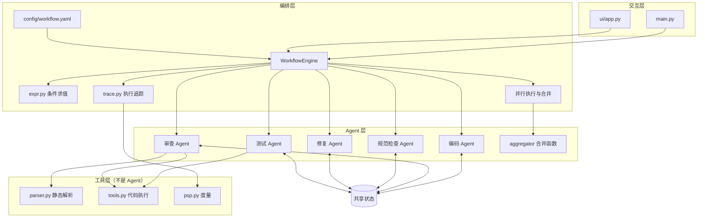
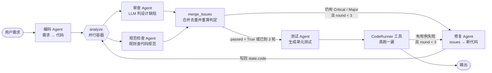
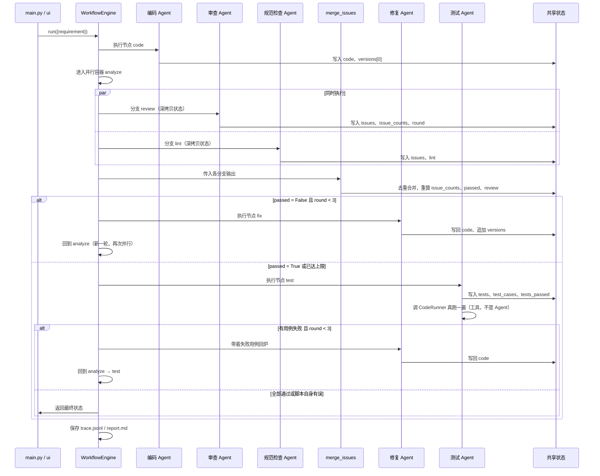
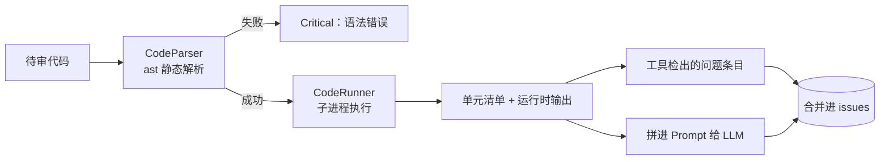

# 设计文档

## 1. 设计目标

搭建一个多 Agent 协作的 Workflow，理解 Workflow 编排、Agent 间通信、状态管理等核心概念。
具体要满足：

- 至少 2 个 Agent 协作完成一个完整流程（本项目 5 个，另有 2 个工具与 1 个合并函数）
- Agent 之间既能传递消息，也能共享状态
- 支持顺序执行，并进一步支持条件分支、循环与并行执行
- 架构可扩展：新增 Agent 或改流程不需要动引擎

## 2. 总体架构



并行执行放在编排层而不是 Agent 层：Agent 依旧只是 `fn(state) -> state`，
它不知道自己是串行跑还是和别人同时跑，并发与合并的复杂度全留在引擎里。

**分层理由**：编排层不知道 Agent 具体做什么，Agent 也不知道自己被谁调度。
两者通过统一的函数签名 `fn(state) -> state` 和共享状态解耦，
因此新增 Agent 是横向扩展，不影响引擎代码。

## 3. 流程图



## 4. 时序图



## 5. Agent 职责

| Agent | 模块 | 读 | 写 | 说明 |
| --- | --- | --- | --- | --- |
| 编码 Agent | `agents/coder.py` | `requirement` | `code`、`versions[0]` | 根据需求生成初版代码 |
| 审查 Agent | `agents/reviewer.py` | `code`、`round` | `issues`、`issue_counts`、`review`、`summary`、`passed`、`round` | 输出结构化 JSON，按等级条数判定放行 |
| 规范检查 Agent | `agents/linter.py` | `code` | `issues`、`lint` | 纯规则查规范，不调 LLM，几毫秒出结果 |
| 合并函数 | `agents/aggregator.py` | 各分支输出 | `issues`、`issue_counts`、`passed`、`review` | 并行结束后汇总去重并重算派生字段 |
| 修复 Agent | `agents/fixer.py` | `code`、`review`、`test_failure` | `code`（回写）、`fixed`、`versions` | 按审查意见与失败用例改代码并写回共享状态 |
| 测试 Agent | `agents/tester.py` | `code` | `tests`、`test_cases`、`test_summary`、`tests_passed`、`test_failure` | 生成单元测试，再调 `CodeRunner` 真跑一遍 |

规范检查 Agent 与审查 Agent 的分工原则：**LLM 判断"设计是否合理"，
规则判断"是否符合规范"**。前者需要语义理解，后者用 ast 查一遍更稳、更快、不花钱，
也不需要等网络。两者报出的问题结构完全一致，因此可以合并进同一份 `issues`。

**Agent 与工具的界线**：一个 Agent 是"能自主决策、读写共享状态的角色"，
`CodeRunner` 没有状态也不做决策，只是被调一次拿回输出 —— 它是工具，不占 Agent 名额。
测试 Agent 用 LLM 想出边界用例（决策），用 `CodeRunner` 执行（工具），分工同上。

**审查与测试不能互相替代**：审查判断"代码写得对不对"（读代码），
测试验证"代码跑起来对不对"（真执行）。审查说"这个函数没问题"，
不代表它在边界输入上真能给出正确结果。

## 6. 共享状态

流程里所有 Agent 读写同一个字典，字段约定如下：

| 字段 | 类型 | 由谁写 | 含义 |
| --- | --- | --- | --- |
| `requirement` | str | 调用方 | 原始需求 |
| `code` | str | coder / fixer | **当前版本代码**，审查始终读它 |
| `versions` | list | coder / fixer | 每版代码快照，含 `round` / `source` / `code` |
| `review` | str | reviewer | 渲染好的 Markdown，供修复 Agent 阅读 |
| `issues` | list | reviewer / linter，由 merge 汇总 | 结构化问题：`level` / `line` / `description` / `suggestion` / `source` |
| `lint` | dict | linter | 本次规范检查的单元数与问题数 |
| `issue_counts` | dict | reviewer | Critical / Major / Minor 各多少条 |
| `summary` | str | reviewer | 一句话总结 |
| `passed` | bool | reviewer | 是否放行 |
| `round` | int | reviewer | 已完成的审查轮次 |
| `degraded` | bool | reviewer | 审查结果是否走了降级路径 |
| `tests` | str | tester | 生成的测试代码（已剔除对被测代码的重复定义） |
| `test_cases` | list | tester | 每个用例的 `name` / `status` / `message` |
| `test_summary` | str | tester | "N 通过 / M 失败" |
| `tests_passed` | bool | tester | 至少跑起来一个用例且全部通过 |
| `test_failure` | str | tester | 失败用例名与报错，供修复 Agent 定位 |
| `test_script_broken` | bool | tester | 测试脚本自身有误 → 不据此回炉 |
| `test_contaminated` | list | tester | 被剔除的重复定义名（测试里抄了被测代码） |

**为什么不直接用函数返回值串联**：那样每一步只拿到上一步的局部结果，
无法回看历史、无法做跨轮次判断（比如"修了 3 轮还是不行就收尾"），也无法记录执行过程。
共享状态让所有 Agent 面对同一份上下文。

## 7. Prompt 设计

审查 Agent 的质量取决于输出能否被机器消费，因此 Prompt 的重点是**约束输出格式**：

- **System**：只声明角色与"只输出 JSON"，不夹带其他要求
- **User**：给出代码 + 明确的三档等级定义 + JSON 结构示例
- **`temperature = 0.2`**：审查需要稳定，不希望每次结论漂移

等级定义写得比较死，是为了避免 LLM 自由发挥成 `high` / `严重` / `blocker` 导致下游无法统计；
即便它真的这么写，解析层也有归一化兜底。

## 7.5 本地工具辅助审查（`agents/inspector.py`）

审查不能只听 LLM 的一面之词。每次审视代码前，`Inspector` 会先采集客观事实：



- **静态层**：`parser.CodeParser`（Homework 1）用 ast 拆出函数/类，顺带抓语法错误。
  解析不通时无法执行，直接定 Critical。
- **运行时层**：`tools.CodeRunner`（Homework 1）在子进程里跑代码，10s→5s 超时保护。
  此外还会按函数签名里的**类型注解**自动构造示例入参去调用函数，
  列表类参数额外试一轮空值，专门逼出下标越界这类边界缺陷。
- **判定原则**：崩溃、超时、非 I/O 类异常定 Major；
  `FileNotFoundError` 这类多半是示例入参不合理造成的，降级为 Minor，
  避免把本来正常的代码卡死在修复循环里。
- **不依赖 LLM**：即便 LLM 输出解析失败走了降级路径，工具查出的问题依然保留。

#### 坑：把"正确拒绝"误判成"代码有缺陷"

探针会**故意**用空列表这类边界入参去调用。这时函数有两种反应，在子进程里看起来却一样：

| 反应 | 性质 |
| --- | --- |
| 自己 `raise ValueError("列表不能为空")` | **正确行为** —— 按预期拒绝了非法入参 |
| 内部运算炸了（`IndexError` / `ZeroDivisionError`） | **缺陷** |

初版不区分，一律定 Major。后果很严重：需求是"计算列表平均值"时，编码 Agent 第一版
就写了空列表校验，却被判成有缺陷 → 修复 Agent 改一遍 → 还是被判有缺陷 →
一路空转到 3 轮上限，最后报"未通过"，而代码其实从头到尾都是对的。

修法是加一层静态信息 `declared_raises()`：用 ast 扫出每个函数自己 `raise` 了哪些异常类型，
探针抛出的异常若在名单里，就说明这是**有意为之的入参校验**，定 Minor 并改文案说明。
拿不到这份静态信息时（比如换了别的实现）保持原来的保守判定。

同一需求的前后对比：

| | 轮次 | 结果 | 遗留 |
| --- | --- | --- | --- |
| 修复前 | 3 轮跑满 | 未通过 | Major 1 |
| 修复后 | 1 轮 | 通过 | Major 0 |

这也说明一件事：**自动化审查工具的误报比漏报更麻烦** —— 漏报最多是没发现问题，
误报会让流程在一个本来正确的产物上空转。

> 安全性说明：自动探针会在子进程里执行待审代码，有两道保护 ——
> 子进程隔离 + 5 秒超时，并可用 `CRW_ENABLE_RUNTIME=0` 整体关闭。

## 7.6 测试环节的可信度（`agents/tester.py`）

审查是"读代码"，测试是"真跑一遍"。但**测试本身也可能是错的**，
一个不可信的测试结果比没有测试更糟 —— 它会给出错误的放行信号。
这里挡了三类失真，全部有回归用例盯着：

**一、测试脚本自己写错了，不能让代码背锅。**
LLM 会写出 `from solution import xxx`（它以为被测代码在独立模块里，
实际是拼进同一个文件），一 import 就 `ModuleNotFoundError`，0 个用例。
若直接判成"测试未通过"，流程会拿一个根本不存在的缺陷让代码白修三轮。

改法三层：Prompt 明令禁止 import 被测代码 → 带真实报错自愈重试一次
（`build_tester_repair_messages`，重试有依据而非碰运气）→ 仍失败则置
`test_script_broken`，YAML 条件写成
`not get('tests_passed', False) and not get('test_script_broken', True)`，
只有"测试真的跑了且失败"才回炉。

归属判定靠 traceback 行号：`CodeRunner` 用 `preamble + "\n\n" + code` 拼接，
被测代码占前 N 行，测试代码从第 N+2 行开始。错误落在哪半边，就是谁的锅 ——
被测代码自己 import 挂了仍然要回炉，只是不能反过来甩给测试。

这和 7.5 那条是同一类教训：**工具或脚本自己的失误，不能算到产物头上。**

**二、测试里不许自带一份实现副本。**
模型偶尔会把整个函数原样抄进测试文件，于是跑的是副本而不是真代码 ——
被测代码再烂也能"全绿"。真实运行里抓到过（`camel_to_snake` 一例）。
改法：`ast` 比对两边模块层定义的名字，交集一律从测试里剔除，
并在报告与界面上如实标注剔了哪些（`test_contaminated`）。

**三、没有被测代码时不许跑测试。**
否则模型会自己写一份实现再自己测，刷出"6 通过 0 失败"，把空产物粉饰成合格。

**为什么不用 pytest**：被测代码和测试拼进同一个文件用 `python -c` 跑，
子进程零依赖。`HARNESS` 逐个调用 `test_` 开头的函数，捕获异常后打印
`RESULT PASS/FAIL <name> <msg>`，再由 `parse_results` 数出通过/失败数。
代价是不支持 fixture / 参数化，这一点写进了已知限制。

## 8. 流程控制

### 顺序

`code → review`

### 并行

一个节点可以声明成**并行容器**：它自己不执行 Agent，而是把列出的分支同时跑完再合并。

```yaml
- id: analyze
  parallel: [review, lint]
  merge: merge_issues
  next:
    - when: "not passed and round < 3"
      goto: fix
    - goto: done
```

为什么值得并行：`review` 要等一次 LLM 往返（实测 3.5 秒），`lint` 是纯本地规则（实测 0.5 毫秒）。
串行跑总耗时是两者之和，并行后只取决于慢的那一个。实测一次运行的轨迹：

| 节点 | 耗时 |
| --- | --- |
| `analyze/review` | 3507.0 ms |
| `analyze/lint` | 0.5 ms |
| `analyze`（容器合计） | 3507.7 ms |

容器耗时约等于最慢分支，而不是各分支之和，这本身就是"确实并行了"的证据。

**合并语义**（这里踩过坑）：

1. 每个分支拿到的是 `state` 的**深拷贝**，互不干扰；
2. 引擎只把各分支"改动过的字段"覆盖回主状态，**失败的分支不合并**（它可能只写了一半）；
3. 跨分支的派生字段由配置里的 `merge` 函数重算 —— 引擎不知道 `issues` 该追加还是覆盖。

第 3 点是必需的。最初图省事让引擎直接把列表"追加"合并，结果上一轮的问题残留到下一轮：
分支明明清空了自己的 `issues`，主状态里却还留着旧条目，`passed` 永远翻不了身，
`round` 一路跑到上限才停。现在的 `merge_issues` 明确地**从各分支输出重新收集**再按
`(等级, 描述)` 去重，`test_parallel.py` 里留了回归用例盯着这件事。

**并行下的失败分层**：

| 层 | 配置 | 行为 |
| --- | --- | --- |
| 分支 | `on_error: abort`（默认） | 该分支的失败会上报给容器 |
| 分支 | `on_error: skip` | 分支挂了就当没跑，不影响整体（规范检查用这条） |
| 容器 | `on_error: abort` | 有分支上报失败 → 抛 `NodeExecutionError` |
| 容器 | `on_error: skip` | 容忍失败，继续走 `next` |

两条分支的耗时差了两个数量级，正好适合说明并行的收益；而辅助分支配 `skip`，
也演示了"非关键路径的失败不该拖垮主流程"。

**限制**：暂不支持嵌套并行（并行容器里不能再放并行容器），配置加载时会直接抛 `ConfigError`。
嵌套会让步数统计、trace 层级和失败语义都复杂化，收益又不明显，因此先不做。

### 条件分支

YAML 里每个节点可以有条件列表：

```yaml
next:
  - when: "not passed and round < 3"
    goto: fix
  - goto: done          # 都不成立时的兜底
```

`when` 由 `workflow/expr.py` 求值。**这里没有用 `eval()`** ——
配置等同于外部输入，一旦被人改成 `__import__("os").system(...)` 就会被原样执行。
白名单只放行：字面量、变量取值、属性访问、下标、比较、布尔、四则运算，
以及 `len` / `sum` / `max` 等纯函数，其余语法一律拒绝。

### 循环

`fix → review` 构成回炉，终止条件写在 `when` 里（`round < 3`）。
引擎另有全局 `max_steps = 50` 兜底，配置写错成环时抛 `StepLimitExceeded` 而不是卡死。

### 配置校验

加载 YAML 时立即检查：缺 `start` / `nodes`、节点缺 `id` / `agent`、`id` 重复、
引用了未注册的 Agent、跳转目标不存在——全部 fail fast。

## 9. 错误处理与恢复

| 层次 | 情况 | 处理 |
| --- | --- | --- |
| 审查输入 | 代码语法错误 | 工具直接定 Critical，交由下一轮修复 |
| 审查输入 | 运行时崩溃/超时 | 工具定 Major，连同堆栈一起交给 LLM |
| 审查输入 | 探针触发的异常 | 函数自己 raise 的定 Minor（预期行为），其余按崩溃定 Major |
| LLM 调用 | 网络抖动、限流 | `llm_client` 重试 3 次，指数退避 |
| 审查输出 | LLM 不按 JSON 输出 | 用纠错 Prompt 重试 1 次 |
| 审查输出 | 重试仍失败 | 降级：`passed = False`、`degraded = True`，原因写进状态 |
| 节点执行 | Agent 抛异常 | 引擎按 `retries` 重试（默认再试 1 次） |
| 节点执行 | 重试仍失败 | 按 `on_error` 处置：中断 / 跳过 / 转兜底节点 |
| 并行分支 | 分支抛异常 | 先看分支自己的 `on_error`：`skip` 则忽略，`abort` 则上报容器 |
| 并行容器 | 有分支上报失败 | 由容器的 `on_error` 决定中断还是继续 |
| 并行合并 | merge 函数抛异常 | 记为容器失败，同样交给 `on_error` 处置 |
| 全局 | 疑似成环 | 超过 `max_steps` 抛 `StepLimitExceeded` |
| 配置 | 任何不合法 | 加载期抛 `ConfigError`，不会带病运行 |

并行配置本身也在加载期校验：分支不存在、`parallel` 为空、嵌套并行、
引用了未注册的 `merge` 函数——都会立即报错，不会等到运行时才炸。

所有失败都会写进 trace，包括被中断的那一次。

## 10. 执行追踪

每次运行产出：

```
runs/20261019-193000-a1b2c3d4/
├── trace.jsonl    每行一条节点记录，机器可读
└── report.md      表格化的执行报告，人可读
```

每条记录包含步骤号、节点名、轮次、耗时、成功与否、状态字段变化摘要、跳转目标。
界面上的实时轨迹表格读的是同一份数据。

## 11. 可视化界面

`ui/app.py` 用 Gradio 搭建，配色走深色控制台（GitHub Dark / Linear 那一路）：

- 底 `#0d1117`、卡片 `#161b22`、边框 `#30363d`、正文 `#e6edf3`、次要 `#8b949e`
- 强调色按语义分：绿 `#3fb950` 通过、红 `#f85149` 失败、琥珀 `#d29922` 进行中
- 节点按类型分配色相：编码蓝 `#58a6ff`、审查紫 `#a371f7`、规范检查青 `#39c5cf`、修复橙 `#d29922`
- 标题、数值、节点 id 用等宽字体，不放 emoji、不用渐变
- 工作流在后台线程执行，主线程轮询 trace 队列增量刷新，不会卡住界面

图形表达只用在有信息量的地方，不做纯装饰：

| 元素 | 表达什么 |
| --- | --- |
| 节点 SVG 图标 | 这一行是哪类 Agent（编码 / 审查 / 规范检查 / 修复 / 并行） |
| 耗时条形图 | 长度按相对最慢节点算，`3507ms` 与 `0.5ms` 的差距一眼可见 |
| 统计格左侧色条 | 通过绿、未通过红，Critical / Major 非零直接转红 |
| 状态点 | 就绪灰、运行琥珀、成功绿、失败红，带一圈柔光 |

耗时条形图是这一版最有用的一处：**它把"并行为什么值"变成了视觉事实** ——
审查分支一条长条、规范检查分支几乎空着，两条并排，容器总耗时约等于长的那个。

### 三个 Gradio 的坑（都踩过）

1. **`css` 参数在 Gradio 6 里从 `Blocks()` 挪到了 `launch()`**。
   放在构造函数里不会报错，只是被静默忽略 —— 这是界面好几个版本样式始终"没生效"
   的真正原因，排查了很久才在警告信息里发现。
2. **输入框只写 `color` 改不动文字**。Gradio 用 `-webkit-text-fill-color` 压着，
   不起眼但效果就是"黑底黑字"，必须连它一起改。
3. **逐个覆盖元素压不住配色**。Gradio 的组件颜色来自一套 CSS 变量
   （`--body-text-color` / `--block-background-fill` / `--input-background-fill` …），
   改元素选择器只能修好一部分，必须把变量本身改掉，整页才会一致。

教训：换主题别急着一个组件一个组件改样式，先找到框架的变量层。

界面自上而下四块，信息密度向 GitHub Actions 的运行详情页看齐：

| 区块 | 内容 | 数据来源 |
| --- | --- | --- |
| 运行状态条 | 就绪 / 运行中 · 已完成 N 步 / 通过 / 未通过 / 执行中断，带状态点 | 运行进度 |
| 结果统计 | 轮次、结果、Critical / Major / Minor、代码版本数，六个统计格 | 共享状态 |
| 执行轨迹 | 每步的节点、轮次、耗时、成功与否、跳转；并行分支缩进一行 | Trace |
| 流程定义 | 节点 / 类型 / 执行内容 / 重试 / 失败策略 / 下一跳 | **直接读 YAML** |
| 审查意见、最终代码 | Markdown 与高亮代码 | 共享状态 |

**流程定义那张表是自动生成的**：改 YAML，界面跟着变，不需要改代码。
这也顺带把作业"推荐实现"里的**可视化 Workflow 编排界面**落到了实处 ——
界面不只展示"跑得怎么样"，还能看清"流程长什么样"：哪个节点是并行容器、
分支有哪些、条件跳转的 `when` 怎么写的、失败策略是什么。

## 11.5 PSP 度量与缺陷追踪

课程第 2 讲讲的是 **PSP（Personal Software Process）**，核心是四个度量：

| 度量 | 含义 | 本项目从哪里拿 |
| --- | --- | --- |
| **Size** | 规模，多少行代码 | 版本快照里的代码，ast 数函数 |
| **Effort** | 时间，花在哪个阶段 | 轨迹里每个节点的 `duration_ms` |
| **Quality** | 质量，缺陷多少、修没修 | 每轮的问题快照 `defect_log` |
| **Schedule** | 进度，计划 vs 实际 | 轮次上限 3 对比实际轮次 |

这些东西本来就在项目里躺着 —— 只是没按 PSP 的方式组织。所以加一个
`workflow/psp.py`，把一次运行压成这四组数据，输出到轨迹报告和界面上。

### 缺陷追踪怎么算

PSP 关心"缺陷何时注入、何时发现、何时修复"。项目里能直接观察到后两个：

`merge_issues` 在每轮并行合并后往 `state["defect_log"]` 追加一份问题快照
（只留最后一轮是推不出历史的）。然后按 `(等级, 描述)` 作为缺陷身份回溯：

- **发现轮次** = 第一次出现在哪一轮
- **修复轮次** = 最后一次出现的下一轮（下一轮没有了，说明修好了）
- **遗留** = 最后一轮还在的问题，不管中间消失过没有

> 注入时刻没法从外部判断 —— 问题可能第 1 轮就埋下了，只是第 2 轮才被查出来。

一次真实运行的结果（13 个缺陷）：

| 指标 | 数值 |
| --- | --- |
| 发现 / 修复 / 遗留 | 13 / 5 / 8 |
| 修复率 | 38% |
| 缺陷密度 | 59.1 / 100 行 |
| 按来源 | LLM 审查 7、规范检查 4、工具探针 2 |

**"按来源"这一栏值得单独说**：三类检查发现的问题几乎不重叠，说明
"LLM 判设计 + 规则查规范 + 工具验运行时"这个分工是成立的，不是三份重复劳动。

### Effort 的记账规则

并行部分容易算重，所以定两条规则：

- **分支节点**（`analyze/review`）算进所属阶段，同时累加进 `branch_ms`
- **并行容器**（`analyze`）只记进 `container_ms`，不进阶段合计 ——
  它的耗时已经等于最慢分支了，再加一遍就是重复

### 一个诚实的结论：并行在这里几乎不省时间

`parallel_saving = 1 - container_ms / branch_ms`。实测下来这个值约等于 0：

```
审查      3507.0 ms
规范检查     0.5 ms
容器合计  3507.7 ms
```

串行要 3507.5ms，并行要 3507ms，**只省下 0.5 毫秒**。因为规范检查太快了，
快到可以被完全隐藏在审查的等待里。报告里如实写了这一点，没有拿"并行"
去充性能数字。

那并行的价值在哪？**在架构上** —— 再加一个慢分支（比如第二个 LLM 审查视角）
不会让总时长变长。这一条才是并行真正值得写进设计的地方。

## 12. 可扩展性

| 想做的事 | 改哪里 |
| --- | --- |
| 加一个 Agent | 写个 `fn(state) -> state`，注册进 `AGENT_REGISTRY`，在 YAML 加节点 |
| 改流程顺序 | 改 YAML 的 `next` |
| 改跳转条件 | 改 YAML 的 `when` |
| 让几个节点同时跑 | 在 YAML 加 `parallel` + `merge`，不用改引擎 |
| 改重试与失败策略 | 改 YAML 的 `retries` / `on_error` |
| 换 LLM | 改 `.env`，或替换 `agents/llm_client.py` |
| 加审查维度 | 改 `agents/prompt.py` 里的模板 |
| 把整批 Agent 换掉 | 换一张 `AGENT_REGISTRY`，YAML 与引擎都不动 |

以上都不需要修改 `workflow/engine.py`。

最后一条有**可运行证据**：`python main.py --mock` 用 `agents/mock.py` 里的一组桩 Agent
替换掉全部 LLM 调用，跑的是**同一份 `config/workflow.yaml`、同一个引擎**，
三轮跑出两种回炉（审查拦一次、测试再拦一次）后正常收尾。
`tests/test_mock_flow.py` 把这条轨迹固定成了回归用例 —— 哪天有人把引擎和 Agent
耦合起来，这个用例会先挂。

顺带它解决了一个实际问题：换台机器 clone 下来没配 API key 也能验证编排。
为此 `LLMClient` 的密钥校验从构造时延后到了真正发起请求时 ——
原先各 Agent 模块在**导入阶段**就构造 client，缺密钥会直接抛错，
导致整套测试在收集阶段就崩、一条用例都跑不到。

## 13. 测试策略

| 文件 | 覆盖内容 | 条数 |
| --- | --- | --- |
| `test_engine.py` | 顺序执行、条件分支、节点缺失、YAML 加载 | 4 |
| `test_review_loop.py` | 修复结果回写、版本快照、每轮审查的代码必须变化 | 4 |
| `test_reviewer.py` | JSON 解析、等级归一化、通过判定、重试与降级 | 25 |
| `test_expr.py` | 合法条件求值、危险语法拒绝 | 13 |
| `test_trace.py` | 状态差分、记录、落盘 | 7 |
| `test_engine_safety.py` | 配置校验、步数上限、重试与失败策略 | 14 |
| `test_code_output.py` | 输出清洗：Markdown 围栏剥离与版本快照 | 7 |
| `test_inspector.py` | 静态解析、运行时探针、示例入参生成、异常分级、显式校验与崩溃的区分 | 43 |
| `test_parallel.py` | 并发性计时、分支状态隔离、合并去重、陈旧问题不残留、失败分层、并行配置校验 | 13 |
| `test_psp.py` | 规模统计、阶段耗时、容器不重复计、缺陷生命周期、密度、轮次预算、渲染 | 17 |
| `test_tester.py` | 结果解析、真实执行、责任归属（代码的锅 / 脚本的锅）、污染剔除、自愈重试、流程接线 | 32 |
| `test_mock_flow.py` | 离线桩流程端到端、两种回炉、Minor 不阻塞、缺密钥时仍能导入与构造 | 8 |
| `test_ui_render.py` | 配色/图标/图例表完整性、逐节点渲染、含 test 节点的完整轨迹、占位状态 | 15 |

合计 202 条。除 `test_inspector.py` 与 `test_tester.py` 需要真实子进程验证执行效果外，
其余全部用桩或 mock 替换 LLM，不产生真实调用费用。

**整套测试不依赖 API key**：`conftest.py` 在没有密钥时补一个占位值，
保证 `import agents.*` 不会因为缺密钥而在收集阶段炸掉；
`tests/test_mock_flow.py` 会在无密钥和有密钥两种环境下各跑一遍确认。

`test_parallel.py` 里有一条**并发性**用例值得单独说：两个分支各 `sleep(0.3)`，
断言容器耗时明显小于两者累加（`< 75%`）。这条用例的意义是防止哪天有人把
`ThreadPoolExecutor` 换成朴素的 `for` 循环，并行悄悄退化成串行而没人发现。

## 14. 已知限制与后续迭代

- 并行节点暂不支持嵌套（并行容器里不能再放并行容器）。
- 修复 Agent 目前整体重写代码，下一步可以按 issue 精确定位到函数级修改。
- 状态仍是裸字典，可以进一步封装成带字段校验的 `WorkflowState` 类。
- 自动探针只对「所有参数都有可识别类型注解」的函数下手，无注解的函数不参与运行时探测。
- `reporter.py` 仍未接入。
- 测试执行器只支持 `test_` 开头的函数配 `assert`，不支持 pytest 的 fixture / 参数化
  （换取子进程零依赖）。
- 测试代码在子进程里执行，与审查探针一样依赖进程隔离与超时，不提供沙箱级安全保证。
