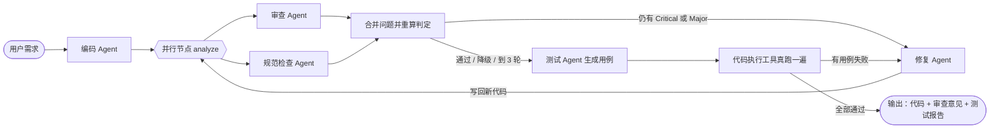

# code-review-workflow

> 仓库地址：https://github.com/fxliu926/code-review-workflow-fxliu

一个多 Agent 协作的 Workflow：给一句需求，多个 Agent 依次完成
**编码 → 并行审查 → 修复 → 单元测试**，审查不通过就带着问题列表回炉再审，
测试跑不过就带着失败用例回炉再改，直到通过或达到轮次上限。

流程本身由 YAML 描述，引擎通用；加一个 Agent 只需要改配置，不用改引擎。

## 快速开始

```bash
git clone https://github.com/fxliu926/code-review-workflow-fxliu.git
cd code-review-workflow-fxliu

python -m venv venv
venv\Scripts\activate                  # Linux / macOS: source venv/bin/activate
pip install -r requirements.txt

pytest tests/ -q                       # 202 条，不需要密钥
python main.py --mock                  # 不需要密钥，跑完整流程（3 轮两种回炉）
```

要用真实 LLM 跑，把 `.env.example` 复制成 `.env`、填入密钥，再：

```bash
python main.py "写一个函数，判断字符串是否是回文，忽略大小写和空格"
python ui/app.py                       # 可视化界面 → http://127.0.0.1:7860
```

> 需要 **Python 3.10+**。`--mock` 用的是桩 Agent，不调用 LLM；
> 想验证流程编排但手边没有密钥时用这个。

## 功能特性

- **多个 Agent 协作**：编码 Agent、审查 Agent、规范检查 Agent、修复 Agent、测试 Agent
- **共享状态**：所有 Agent 读写同一个状态字典（`requirement` / `code` / `issues` / `round` …）
- **结构化审查**：审查 Agent 输出 JSON 问题列表，按 Critical / Major / Minor 的实际条数判定放行，
  不再靠匹配报告里的关键字这类不可靠做法
- **本地工具辅助**：审查前先用 ast 解析、再把代码真跑一遍；语法错误和运行时崩溃
  由工具直接定为 Critical / Major，不依赖 LLM 是否发现；
  函数自己 `raise` 的入参校验则识别为预期行为，不算缺陷
- **并行节点**：耗时的 LLM 审查与瞬时的本地规范检查同时跑，再合并两边的问题统一判定
- **回炉循环**：审查未通过时由修复 Agent 改代码，结果写回共享状态后重新审查，最多 3 轮
- **单元测试闭环**：测试 Agent 写用例、代码执行工具真跑一遍；失败的用例名与报错
  会一并交给修复 Agent。审查判断的是"代码写得对不对"（读代码），
  测试验证的是"代码跑起来对不对"（真执行），两者不能互相替代
- **测试可信度保障**：静态剔除测试里对被测代码的重复定义（否则跑的是副本、结果全是假的），
  并区分"被测代码有 bug"与"测试脚本自己写错了"——后者不会让代码背锅回炉
- **配置化流程**：节点顺序、跳转条件、重试与失败策略都写在 `config/workflow.yaml`
- **条件求值安全**：跳转条件用自研的受限求值器执行，替代了原来的 `eval()`
- **执行追踪**：每次运行落盘 `runs/<时间戳>/trace.jsonl` 与人类可读的 `report.md`
- **PSP 度量**：自动采集 Size（代码行数）/ Effort（各阶段耗时占比）/
  Quality（缺陷数、修复率、缺陷密度）/ Schedule（轮次预算）；
  并追踪每个缺陷在哪一轮发现、有没有修好
- **错误恢复**：节点级重试，失败策略可配（中断 / 跳过 / 转去兜底节点）
- **可视化界面**：实时展示执行状态、耗时、轮次与跳转；
  并按 YAML 自动生成流程定义表（节点 / 并行分支 / 条件跳转 / 失败策略）
- **单元测试**：202 条，覆盖引擎、并行执行、条件求值、轨迹、审查解析、
  输出清洗、回炉循环、测试执行与责任归属、离线桩流程、PSP 度量
- **离线可跑**：没有 API key 也能跑通整条流程（`--mock`）与全部测试

## 流程



## 环境要求

**Python 3.10 或更高**（代码里用了 `str | None` 这类新写法，3.9 会在定义函数时就报 TypeError）。

## 安装

```bash
python -m venv venv
venv\Scripts\activate        # Linux / macOS: source venv/bin/activate
pip install -r requirements.txt
cp .env.example .env         # 填入密钥；只想看流程编排可以不配，用 --mock 跑
```

## 配置

复制一份环境变量模板并填入自己的密钥：

```bash
cp .env.example .env
```

```
OPENAI_API_KEY=sk-your-api-key
OPENAI_BASE_URL=https://api.deepseek.com/v1
```

默认使用 DeepSeek，兼容 OpenAI SDK，换成其他兼容服务只需改这两个值。

> 界面在启动时读取环境变量，改完 `.env` 需要重启。

## 使用

### 命令行

```bash
python main.py                                    # 用内置示例需求跑一遍
python main.py "写一个归并两个有序列表的函数"       # 指定需求
python main.py "写一个读 CSV 的函数" -o report.md   # 同时导出审查意见
python main.py --mock                             # 不需要密钥也能跑完整个流程
```

输出包含轮次、是否通过、遗留问题的分级计数、单元测试的通过与失败数、
最终代码，以及本次轨迹报告的路径。

### 没有密钥也能跑：`--mock`

`--mock` 用一组桩 Agent 替换掉所有 LLM 调用，**流程和真实运行用的是同一份
`config/workflow.yaml`、同一个引擎**，只是 Agent 实现换了。三轮跑出两种回炉：

```
code → analyze(第 1 轮：审查报 Major) → fix
     → analyze(第 2 轮：审查放行) → test(用例失败) → fix
     → analyze(第 3 轮：审查放行) → test(全部通过) → done
```

它有两个用处：换台机器 clone 下来没配密钥也能验证编排；同时也是
「换 Agent 不动引擎」这条可扩展性说法的**可运行证据**，而不是只在文档里写一句。
（`agents/mock.py`；测试执行仍然走真实的子进程，通过/失败是真跑出来的。）

### 真实运行报告样例

`runs/` 里每一次运行的完整报告不进版本库（太杂），但挑了三份放在 `examples/`：

| 文件 | 看点 |
| --- | --- |
| `examples/sample-run-palindrome.md` | 2 轮：测试失败驱动回炉，14 个用例最终全过 |
| `examples/sample-run-camel-to-snake.md` | 触发了「测试里抄了被测代码」的剔除，报告里会写明剔了哪个 |
| `examples/sample-run-mock.md` | 离线桩模式三轮跑出两种回炉，不需要密钥 |

### 可视化界面

```bash
python ui/app.py
```

浏览器打开 http://127.0.0.1:7860 。填入需求后点「运行审查流程」，
可以看到节点逐个亮起的执行轨迹，以及最后的审查意见和代码。

## 测试

```bash
pytest tests/ -q
```

202 条，**不需要 API key 也能全部跑通**（LLM 一律用桩替换，不产生调用费用）。

## 项目结构

```
code-review-workflow-fxliu/
├── agents/
│   ├── coder.py          编码 Agent：需求 → 代码
│   ├── reviewer.py       审查 Agent：代码 → 结构化问题列表 + 放行判定
│   ├── linter.py         规范检查 Agent：纯规则查代码规范，不调 LLM
│   ├── aggregator.py     并行合并函数：汇总各分支问题并重算判定
│   ├── fixer.py          修复 Agent：问题列表 → 修复后的代码（写回共享状态）
│   ├── tester.py         测试 Agent：生成单元测试 + 执行器 + 结果归属判定
│   ├── mock.py           离线桩 Agent：不调 LLM，用于无密钥演示与可扩展性验证
│   ├── inspector.py      本地事实采集：ast 解析 + 真实执行 + 自动调用探针
│   ├── llm_client.py     LLM 调用封装：重试 + 指数退避
│   ├── prompt.py         Prompt 模板
│   ├── parser.py         HW1 复用：ast 代码解析（由 inspector 调用）
│   ├── reporter.py       HW1 复用：Markdown 报告生成
│   └── tools.py          HW1 复用：代码执行（由 inspector 调用）
├── workflow/
│   ├── engine.py         引擎：节点调度、并行执行、条件跳转、重试与失败策略、步数上限
│   ├── expr.py           受限表达式求值器（替代 eval）
│   ├── psp.py            PSP 度量：Size / Effort / Quality / Schedule + 缺陷追踪
│   └── trace.py          执行轨迹记录与报告生成
├── config/workflow.yaml  流程定义
├── examples/             需求样例、早期版本存档与真实运行报告样例
├── ui/app.py             Gradio 可视化界面
├── tests/                单元测试（202 条）
├── main.py               命令行入口
├── README.md
├── Design.md             设计文档：架构、状态约定、错误处理、可扩展性
└── CHANGELOG.md          迭代记录：每一轮改了什么、为什么改
```

设计取舍与踩过的坑见 [Design.md](Design.md)，版本演进见 [CHANGELOG.md](CHANGELOG.md)。

## 已知限制

- 修复 Agent 目前整体重写代码，还没有做到按 issue 精确定位到函数级别修改。
- 测试执行器只支持 `test_` 开头的函数配 `assert`，不支持 pytest 的 fixture / 参数化
  （刻意如此：让子进程零依赖，被测代码与测试拼起来就能跑）。
- 并行节点暂不支持嵌套（并行容器里不能再放并行容器），配置里会直接报错。
- `reporter.py` 尚未接入；自动探针只对参数带类型注解的函数下手，
  且把它认为"示例入参不合理"的 I/O 类异常降级成了 Minor。
- 识别"显式入参校验"只做静态扫描：函数用 `raise` 之外的手段拒绝入参
  （比如 `assert`，或调用的下游函数抛错）仍会被判为崩溃。

## 环境变量

| 变量 | 默认值 | 说明 |
| --- | --- | --- |
| `OPENAI_API_KEY` | — | 必填 |
| `OPENAI_BASE_URL` | `https://api.deepseek.com/v1` | 兼容 OpenAI 的服务地址 |
| `CRW_ENABLE_RUNTIME` | `1` | 设为 `0` 可关闭自动执行代码的探针 |

详见 [Design.md](Design.md)。
